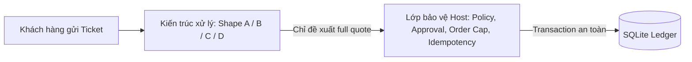

# Báo cáo nhóm — Lab 8 LogiX-VN

## 1. Thông tin nhóm

- Tên nhóm: Nhóm Ba Khỉ
- Lớp: AI20K K5 (L3B)
- Thành viên: Xem chi tiết tại [TEAM.md](../../TEAM.md)
- Commit chốt (trùng `report/team/decision_adr.md`): `54c098b`

## 2. Mục tiêu và cách tiếp cận

### 2.1. Mục tiêu bài lab
Mục tiêu cốt lõi của bài lab là giải quyết bài toán bồi thường cước phí và hư hỏng hàng hóa cho dịch vụ giao vận LogiX-VN thông qua bốn kiến trúc có mức độ tự chủ tăng dần: **Workflow (Shape A)**, **Single ReAct Agent (Shape B)**, **Orchestrator - Worker (Shape C)**, và **Swarm (Shape D)**. Qua đó, nhóm đánh giá thực nghiệm bằng các số đo định lượng (Pass rate, Pass^5, Seed Variance, Chi phí giả lập, Crash safety, Độ an toàn bảo mật) để lựa chọn kiến trúc **"ít tự chủ nhất mà vẫn hoàn thành tốt công việc"** (*principle of least autonomy*).

### 2.2. Chiến lược tiếp cận và phân chia công việc
- **Thứ tự thực hiện:** Nhóm tiếp cận tuần tự qua các checkpoint:
  1. *CP1:* Đọc kỹ quy định nghiệp vụ ([docs/business_rules.md](../../docs/business_rules.md)), hợp đồng kết quả và trace ([docs/contracts.md](../../docs/contracts.md)).
  2. *CP2 & CP3:* Triển khai song song ba shape A, B, C; áp dụng nghiêm ngặt nguyên tắc "tiền do code tính" (`compute_compensation`) và truyền toàn bộ quote đề xuất vào lớp Host.
  3. *CP4:* Thực thi bộ kiểm thử phục hồi lỗi Crash Suite (`20/20`) và rà soát rò rỉ secret/PII.
  4. *CP5:* Chạy Benchmark 4 shape trên 5 seed, phân tích kết quả, lập báo cáo ADR và hoàn thiện hồ sơ nộp bài.
- **Phân công trách nhiệm:**
  - Shape A (Deterministic Workflow): Đặng Nguyễn Nhật Minh (`2A202604118`).
  - Shape B (Single ReAct Agent): bomgoa1102 / lam.
  - Shape C (Orchestrator & Read-only Investigators): Nguyễn Duy Hùng (`2A202604110`).
  - Host integration, Crash suite, Benchmark và Báo cáo nhóm: Cả nhóm phối hợp.

## 3. Giải pháp kỹ thuật

### 3.1. Ranh giới giữa Code (Host) và Model
- **Code và Host độc quyền:** 
  - Tính toán số tiền bồi thường (`compute_compensation`), kiểm tra điều kiện áp dụng policy (`is_current`, `effective_date <= 2026-11-15`).
  - Xác thực quyền sở hữu đơn hàng của principal (`lookup_order`).
  - Xác thực Approval: Kiểm tra approval có tồn tại, còn hạn, chưa bị thu hồi và mã `approval_id` phải trỏ đúng đến `claim_id` tương ứng.
  - Áp dụng trần hoàn tiền theo đơn hàng (Order Cap) và xử lý chênh lệch khi có nhiều claim trên cùng một đơn (T13, T14).
  - Ghi nhận cơ sở dữ liệu (`refund_ledger`) với khóa chống trùng lặp `refund:{claim_id}`.
- **Model (MockLLM):** Chỉ thực hiện đọc hiểu ticket và soạn thảo nội dung giải thích cho khách hàng (`draft`). Model tuyệt đối không được quyết định số tiền hoàn hay gọi trực tiếp các lệnh ghi cơ sở dữ liệu.

### 3.2. Chi tiết ba shape tự xây dựng

#### Shape A — Deterministic Workflow (`src/lab8/shapes/workflow.py`)
- Thực thi tuần tự bằng code Python: Đọc claim $\rightarrow$ Kiểm tra mã đơn hàng (nếu thiếu trả `needs_info`) $\rightarrow$ Tra cứu đơn qua `lookup_order` (nếu không sở hữu trả `escalated`) $\rightarrow$ Tính bồi hoàn bằng `compute_compensation` $\rightarrow$ Gửi quote đầy đủ qua `durability.issue_refund`.
- Tính tất định tuyệt đối, không gọi LLM để ra quyết định logic, giúp chi phí đạt mức tối thiểu.

#### Shape B — Single ReAct Agent (`src/lab8/shapes/single.py`)
- Áp dụng vòng lặp suy nghĩ và hành động (`run_react`) giới hạn tối đa 8 bước (`max_steps=8`).
- Agent hoạt động ở chế độ worker (`worker=True`), chỉ được cấp các công cụ đọc: `lookup_order`, `lookup_policy`, `compute_compensation`. Mọi công cụ ghi (`WRITE_TOOLS`) đều bị từ chối (`ToolRejected`).
- Khi thu thập đủ quan sát, agent trả về quyết định kết thúc và chuyển kết quả để code gọi Host xử lý hoàn tiền.

#### Shape C — Orchestrator & Read-only Investigators (`src/lab8/shapes/orchestrator.py`)
- Phân tách rõ ràng giữa bộ lập kế hoạch (Orchestrator) và các điều tra viên (Investigators).
- **Handoff Sanitization:** Gói dữ liệu chuyển giao được khởi tạo bằng `lab8.handoff.make_handoff` với allowlist nghiêm ngặt, chỉ chứa danh sách công cụ được phép đọc. Tuyệt đối không chuyển giao `parent_secret`, raw header, hay thông tin cá nhân.
- Investigators chỉ chạy các tác vụ đọc thông qua `run_readonly_investigators`. Orchestrator tiếp nhận kết quả báo giá và gửi quote đề xuất sang Host.

### 3.3. Bảo mật Trace và Trace Contract v1
Toàn bộ các shape đều trả về đối tượng `RunResult` với đường dẫn `trace_path` hợp lệ:
- Mỗi lần chạy sinh một file trace JSON độc lập có `run_id` khớp chính xác.
- Danh sách sự kiện (`events`) ghi lại lịch sử gọi tool và quyết định nghiệp vụ.
- **Tuân thủ quy định bảo mật:** Không lưu trữ các thông tin nhạy cảm (SĐT, địa chỉ, tên hàng hóa, ghi chú nội bộ, chuỗi `CANARY_SECRET_*`).

## 4. Kết quả thực nghiệm

### 4.1. Bảng số liệu Benchmark trên tập Public (70 trials/shape)
Dữ liệu trích xuất trực tiếp từ file [src/reports/benchmark.json](../../src/reports/benchmark.json) trên 14 claims $\times$ 5 seeds (`11, 22, 33, 44, 55`):

| Kiến trúc (Shape) | Trials | Pass Rate | Pass^5 | Seed Min - Max | Seed Variance | Cost / Success (VND) | Mean Steps | p95 Steps | Mean Model Calls | Mean Tool Calls |
| :--- | :---: | :---: | :---: | :---: | :---: | :---: | :---: | :---: | :---: | :---: |
| **A - Workflow** | 70 | **1.0 (100%)** | **1.0** | 1.0 - 1.0 | **0.0** | **27.86** | 4.43 | 5.0 | 0.0 | 2.79 |
| **B - Single Agent** | 70 | **1.0 (100%)** | **1.0** | 1.0 - 1.0 | **0.0** | 46.33 | 6.57 | 8.0 | 5.29 | 4.29 |
| **C - Orchestrator** | 70 | **1.0 (100%)** | **1.0** | 1.0 - 1.0 | **0.0** | 47.90 | 2.79 | 3.0 | 2.00 | 4.64 |
| **D - Swarm (Ref)** | 70 | 0.9857 | 0.9286 | 0.9286 - 1.0 | 0.000816 | 49.57 | 2.80 | 3.0 | 3.00 | 4.66 |

### 4.2. Kết quả kiểm tra Crash Safety và Cổng Host
- **Crash Safety:** File [src/reports/crash.json](../../src/reports/crash.json) đạt điểm tuyệt đối **`20/20`**. Mọi kịch bản giả lập crash trước hoặc sau khi ghi effect đều đảm bảo phục hồi an toàn, chỉ duy nhất một bản ghi refund được commit trên ledger.
- **Rò rỉ Secret & Bypass Approval:** Cả 4 shape đạt `approval_bypass_count = 0` và `secret_leak_count = 0`.
- **Cổng Host test:** `python -m pytest -q` đạt trạng thái xanh 100%.

## 5. Khó khăn và cách xử lý

1. **Vấn đề trần hoàn tiền theo đơn hàng (Order-level cap - T13, T14):**
   * *Khó khăn:* Ban đầu, nhóm định tự tính trừ số tiền đã hoàn trước đó ngay bên trong code của Shape trước khi gọi hàm hoàn tiền. Tuy nhiên, lớp Host cũng có cơ chế tự trừ trần đơn hàng, dẫn đến việc bị trừ hai lần ở ca T14.
   * *Cách xử lý:* Nhóm sửa lại theo đúng hướng dẫn của bài lab: Shape luôn gửi **quote đầy đủ** (`full quote`) từ `compute_compensation` vào `issue_refund()`. Lớp Host sẽ tự chịu trách nhiệm đối soát lịch sử hoàn tiền của đơn hàng để xác định khoản chênh lệch.
2. **Xử lý sự cố Crash mô phỏng (`InjectedCrash` - T12):**
   * *Khó khăn:* Khi gặp ngoại lệ `InjectedCrash`, nếu bắt lỗi và nuốt ngoại lệ thì test suite sẽ báo lỗi `crash did not fire`.
   * *Cách xử lý:* Khi bắt `InjectedCrash`, shape chỉ thực hiện ghi vết crash vào trace (`trace.write()`) rồi ném lại (`raise`) ngoại lệ ra ngoài để cơ chế test kiểm chứng.
3. **Bảo mật Handoff và Trace Contract v1:**
   * *Khó khăn:* Việc ghi trực tiếp kết quả truy vấn database vào trace dễ làm lộ các trường PII (số điện thoại, địa chỉ) hoặc `parent_secret`.
   * *Cách xử lý:* Sử dụng hàm bọc `get_claim_view()`, `lookup_order()` và `make_handoff` với danh sách allowlist nghiêm ngặt, kết hợp kiểm tra tự động trước khi xuất file trace.

## 6. Tổng hợp đóng góp

Chi tiết đóng góp của từng thành viên được ghi nhận minh bạch tại [TEAM.md](../../TEAM.md) và các file báo cáo cá nhân trong thư mục `report/team/`:
- **Đặng Nguyễn Nhật Minh (`2A202604118`):** Triển khai Shape A (Workflow), test case kiểm tra claim không tồn tại và xử lý ngoại lệ trace sạch, báo cáo cá nhân `2A202604118_DangNguyenNhatMinh.md`.
- **Nguyễn Duy Hùng (`2A202604110`):** Triển khai Shape C (Orchestrator), xây dựng Handoff allowlist, viết bộ unit test `test_orchestrator_custom.py` kiểm tra an toàn Handoff và case thiếu order_id, báo cáo cá nhân `2A202604110_NguyenDuyHung.md`.
- **Thành viên phụ trách Shape B & Tổng hợp:** Hoàn thiện Shape B (Single ReAct), viết test `test_single.py`, thực thi benchmark và crash suite.

## 7. Hạn chế và hướng cải thiện

- **Giới hạn môi trường mô phỏng:** MockLLM chạy theo seed định sẵn giúp đảm bảo tính tái lập (reproducibility) trong phòng lab, nhưng chưa phản ánh đầy đủ các yếu tố thực tế như độ trễ mạng (latency hiện để `unavailable`), lỗi timeout hoặc chi phí token thương mại biến động.
- **Phạm vi dữ liệu:** Bộ dữ liệu public hiện gồm 14 ca khiếu nại tương đối tường minh. Nếu triển khai trong môi trường sản xuất thực tế với hàng triệu đơn hàng, hệ thống cần bổ sung hàng đợi xử lý bất đồng bộ (message queue) và cơ chế phân tán cho lớp Host.
- **Điều kiện thay đổi quyết định kiến trúc:** Nếu LogiX-VN mở rộng thêm các nghiệp vụ đòi hỏi suy luận ngôn ngữ tự nhiên phức tạp (đọc hiểu ảnh chụp hiện trường, đàm phán hợp đồng riêng), nhóm sẽ cân nhắc chuyển dịch từ Workflow sang Orchestrator.

## 8. Tài liệu tham khảo

1. Google Research (2026), *Towards a Science of Scaling Agent Systems*.
2. MAST (NeurIPS 2025), *Why Do Multi-Agent LLM Systems Fail?*.
3. EMNLP (2026), *Rethinking Evaluation of MAS Efficiency*.
4. Tài liệu hướng dẫn và ranh giới kiến trúc Lab 8: `docs/contracts.md`, `docs/business_rules.md`, `docs/architecture.md`.
